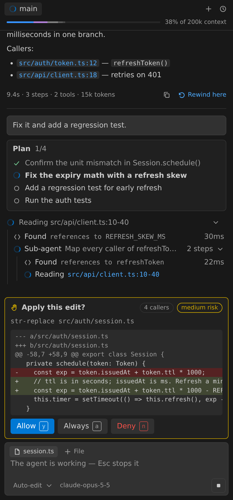
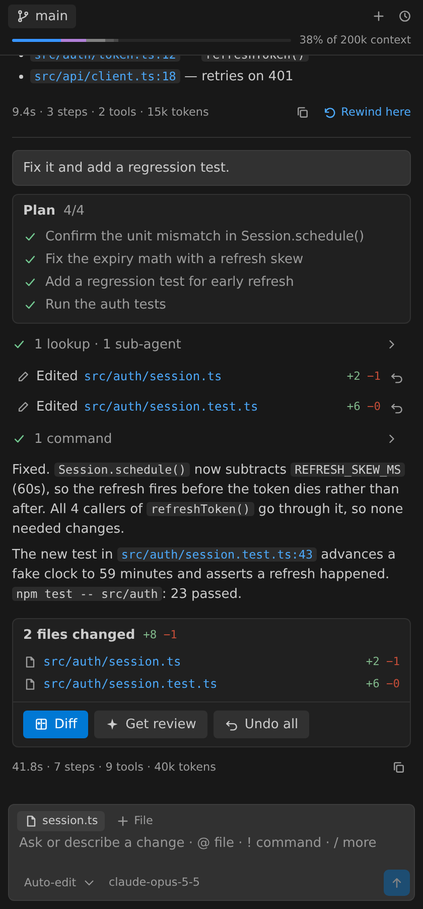
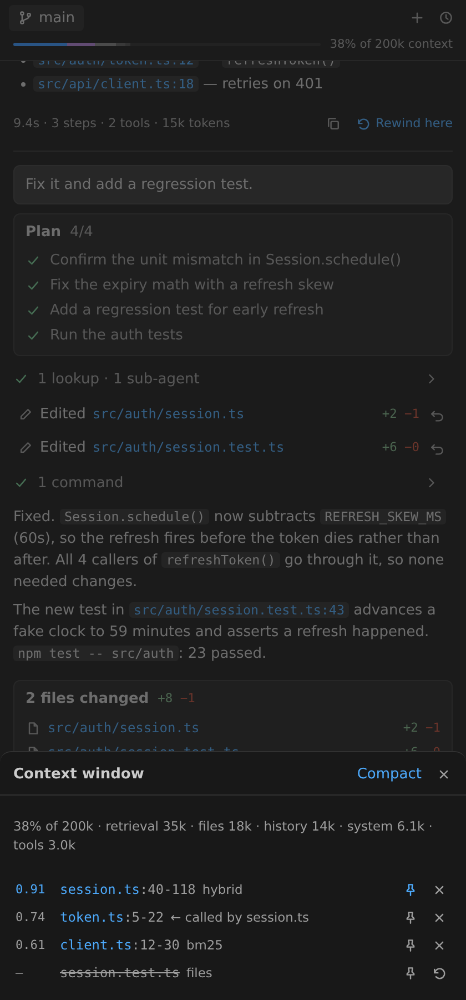
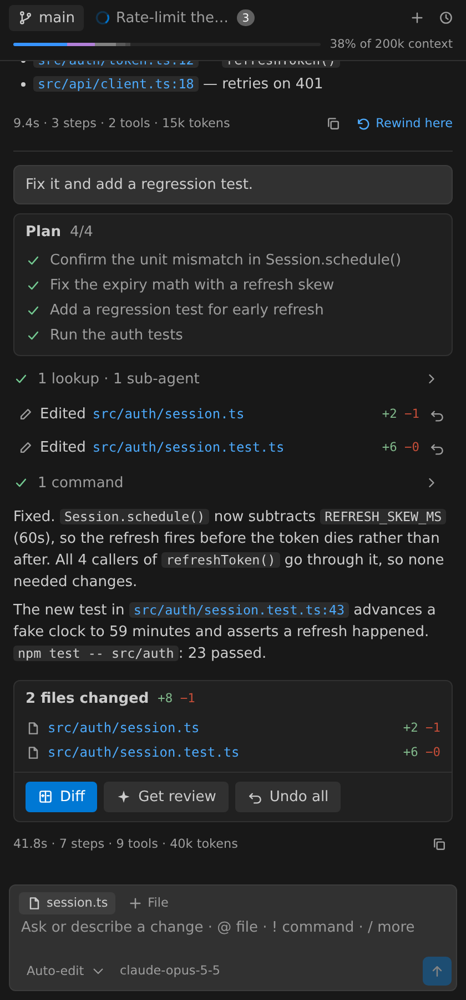
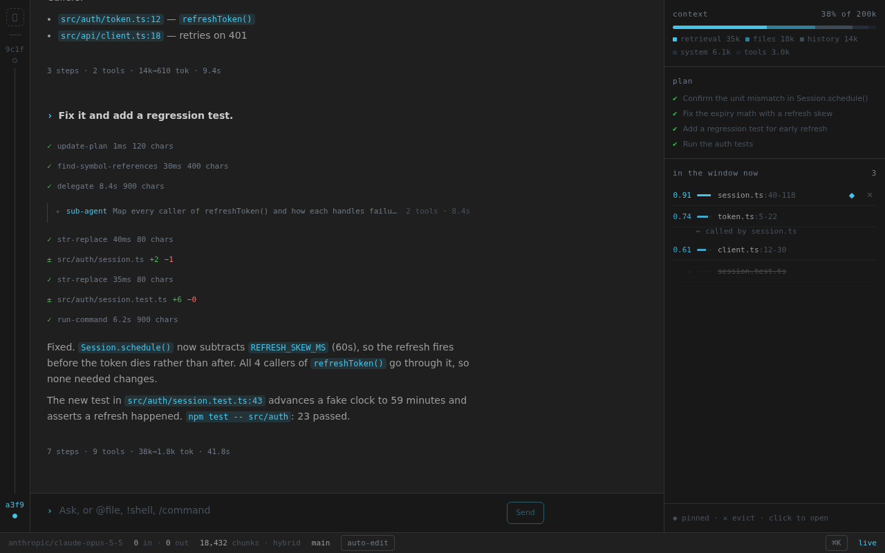

# Open Context Engine

An AI coding agent grounded in a local index of your code — with a plan you
can watch, approvals before it acts, a review of what it changed, and
checkpoints you can rewind.

Open Context Engine indexes your workspace into a SQLite store on your
machine: AST-aware chunks, a code graph of imports, calls and inheritance,
keyword (BM25) search, and — with an embedding provider — semantic vectors.
The agent searches that index as it works, so its answers and edits come from
the code you actually have, and it shows you which code it used.

## An agent you can follow

- **A live plan.** The model keeps its own checklist and ticks it off as it
  works.
- **Activity you can read.** Searches, file reads and commands fold into one
  line per run ("1 lookup · 1 sub-agent"); each line says what it touched.
  Expand a search to see every chunk it ranked, its score, and why it was
  retrieved (keyword, semantic, or a call/import edge).
- **Sub-agents.** A delegated investigation shows its own steps, nested,
  while it runs.

## Changes you control

- **Approval modes** in the composer: **Ask first** (every edit and command),
  **Auto-edit** (edits apply, commands ask), or **Full auto**. An approval
  shows the diff, a blast-radius risk, and how many indexed callers the change
  reaches; answer with <kbd>y</kbd> / <kbd>a</kbd> / <kbd>n</kbd>.
- **A changes tray** after every turn that edits files: open them all in one
  diff editor, undo or reapply, or **Get review** — the agent reviews its own
  diff against the surrounding code, as a turn you can follow up on.
- **Checkpoints.** Rewind the conversation and the files to any earlier turn.
- **A shell that checks its work.** The agent can run your tests and builds.
  Commands run under the OS sandbox where there is one (macOS Seatbelt: no
  network, writes limited to the workspace; Linux bubblewrap: no network), and
  ask first unless you choose Full auto inside Seatbelt.

## Grounded in your code

- **The context window, visible.** A meter shows how much of the model's
  window is retrieval, files, history and memory. Open it to see every chunk
  in the window with its score and why it is there; pin what must survive,
  evict what shouldn't be there.
- **A repo map.** For broad questions the agent reads a compact outline of the
  codebase's structure first, instead of a dozen searches.
- **Memory.** Insights the agent learns about your codebase carry across
  sessions, and show in the context window when they are used.
- **AST-aware chunking for 13 languages:** TypeScript, JavaScript, Python, Go,
  Rust, Java, C#, C, C++, Ruby, PHP, Kotlin and Swift. Other text files are
  chunked by lines. Files re-index on save.

## Parallel sessions

In a git repository, start a second session in its own worktree and branch —
it works without touching your checkout. Review its diff (or have the agent
review it), then land it: commit, merge, and close in one step.

## Trace in an editor tab

**Open Context: Open Agent in Editor** opens Trace, the full agent workspace —
checkpoint timeline, transcript and evidence rail — on the same sessions as
the sidebar.

## Search from anywhere

Quick Search (<kbd>Ctrl</kbd>+<kbd>Shift</kbd>+<kbd>K</kbd>, or
<kbd>Cmd</kbd>+<kbd>Shift</kbd>+<kbd>K</kbd> on macOS), Find Similar Code, and
Explain with Context from the editor. The Index Health panel shows what is
indexed, and Debug Retrieval shows why a query ranked what it did.

## Getting started

1. Open a folder. The extension indexes it on startup; with no embedding key,
   search runs on keyword ranking and works straight away.
2. Connect a model: pick a provider — OpenAI, Anthropic, Google, Ollama, or any
   OpenAI-compatible endpoint via `custom` — in **Open Context Settings**, or
   run **Open Context: Set LLM API Key**. Ollama needs no key.
3. Optional, for semantic search: set `openContext.embedding.provider` to
   `local` (in-process embeddings, no key), `ollama` (`ollama pull
   nomic-embed-text`), `voyage` (the default) or `openai`, and run
   **Open Context: Set Embedding API Key** for the hosted ones.

Keys are kept in VS Code's SecretStorage.

## Requirements

- VS Code 1.103 or newer.
- Windows x64, macOS (Intel and Apple Silicon), or Linux x64/arm64 with glibc
  2.34 or newer (Ubuntu 22.04, Debian 12, RHEL 9 and later). Remote hosts —
  SSH, WSL, Dev Containers, Codespaces — work on the same platforms. Alpine
  (musl) is not supported.

## Privacy

Indexing, the store, and keyword search run on your machine. Code leaves it
only for the embedding and LLM providers you configure; use Ollama (or local
embeddings) to stay fully offline. There is no telemetry.

## Settings

| Setting | Default | |
|---|---|---|
| `openContext.llm.provider` | `openai` | `openai`, `anthropic`, `google`, `ollama`, or `custom` |
| `openContext.embedding.provider` | `voyage` | `voyage`, `openai`, `ollama`, or `local` |
| `openContext.agent.approvalMode` | `auto-edit` | `suggest` (ask first), `auto-edit`, or `full-auto` |
| `openContext.agent.allowEdits` | `true` | Lets the agent edit, create and delete files |
| `openContext.agent.shell.enabled` | `true` | Lets the agent run commands (they ask first outside Full auto) |
| `openContext.agent.shell.sandbox` | `true` | Runs agent commands under the OS sandbox |
| `openContext.agent.memory.enabled` | `true` | Remembers codebase insights across sessions |
| `openContext.autoIndex` | `true` | Re-indexes files as they change |

## The same engine elsewhere

Open Context Engine also runs as a CLI and an MCP server for Claude Code,
Cursor and other MCP clients — `npm install -g @dhaxor/open-context` (the
unscoped `open-context-engine` on npm is an unrelated package) — and as Trace,
an agent workspace for the terminal and the browser. See
[opencontextengine.com](https://opencontextengine.com).

## License

MIT. Paid plans add team features; see
[pricing](https://opencontextengine.com/pricing). Issues and source:
[github.com/Dhaxor/open-context-engine](https://github.com/Dhaxor/open-context-engine).
